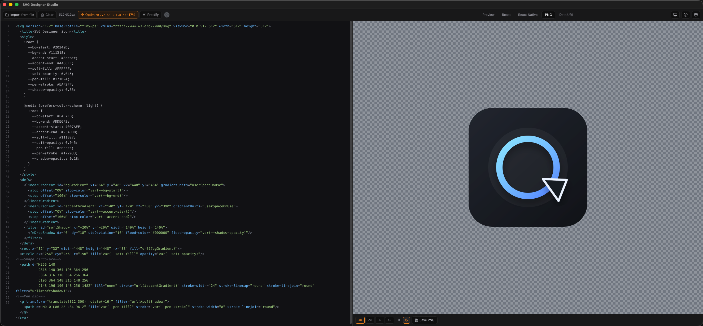

<p align="center">
  
</p>

<h1 align="center">SVG Designer Studio</h1>

<p align="center">
  Native desktop SVG editor — edit, preview, optimize, and export to React / React Native / PNG / Data URI<br/>
  <sub>Built on the <strong>nex</strong> framework · Go + React/Vite · works fully offline</sub>
</p>

<p align="center">
  
  
  
  
  
  
</p>

---

## What is SVG Designer Studio?

SVG Designer Studio is a native desktop application built on the **nex framework** (Go backend + React/Vite frontend, native OS webview).

Open or paste any SVG, tweak it in the editor, and watch the preview update in real time. When ready, export the result as optimized SVG, a ready-to-use React or React Native component, a high-resolution PNG, or a Data URI — all without any internet connection or external tooling.

<p align="center">
  
</p>

---

## Features

| Feature | Details |
|---|---|
| Live editor | Syntax textarea with synchronized line gutter, Tab indent support, live SVG/XML syntax validation with bottom warning and line/column jump, drag-and-drop file loading, file import via native dialog, SVG merge (drop onto a non-empty document) with automatic id-collision-safe, coordinate-system-preserving merge and a minimal X/Y/Scale confirmation popup, snippets menu (rect/circle/ellipse/line/path/text plus wrap-selection-in-`<g>` or an empty `<g transform>` skeleton) |
| Live SVG preview | SVG rendered in real time on a transparent checker background, zoom (25%–1000%) with pan, auto fit-to-view on load and on demand |
| Click-to-select | Click any shape in the Preview to select its full element (syncs the editor's selection to its entire source range, open tag through matching close tag); the root `<svg>` itself is never selectable |
| Optimize | Pure-JS SVGO-like optimizer; shows before/after in KB (e.g. `4.2 KB → 2.8 KB −33%`) |
| Prettify | Indent-formatted SVG via DOMParser/XMLSerializer, preserves all comments (including outside the root `<svg>`) |
| React export | Full JSX component `SvgComponent = (props) => (...)` with camelCase attributes and `{...props}` spread |
| React Native export | `react-native-svg` component with auto-generated imports and PascalCase elements |
| PNG export | Canvas render at 3×–8× density into a 128/256/512/1024 logical base size (aspect-ratio-preserving, centered, transparent padding), independent on-screen zoom/pan/fit-to-view; saves as PNG via native save dialog |
| Data URI | Base64 and URL-encoded SVG data URIs |
| Copy / Download | Every output tab has native clipboard copy and file download via OS save dialog with pre-filled filename and correct file type binding |
| Theme | System / Light / Dark via `nex appearance.info()` — follows native OS appearance |
| Single instance | One window enforced via `dev.vlt.svg-designer` lock |

---

## Requirements

| Tool | Version |
|---|---|
| Go | 1.26.4+ |
| Node | 20.19+ or 22.12+ |
| C compiler | Required by cgo/webview |

Platform extras: macOS needs Xcode Command Line Tools, Linux needs GTK/WebKitGTK development packages (`libgtk-3-dev`, `libwebkit2gtk-4.0-dev`, `libglib2.0-dev`, `pkg-config`) plus a C/C++ toolchain, and Windows builds are produced through the configured mingw-w64 cross target in CI.

---

## Development

```bash
make dev
```

Starts Vite HMR on `127.0.0.1:5179` and the Go backend on `127.0.0.1:34115`.

---

## Build

```bash
make build
```

Output: `release/0.1.1-R291026/<platform>/SVG Designer Studio.app|exe`

**CI**: `.github/workflows/build.yml` runs this same build on every push, one native GitHub-hosted runner per target OS/arch (darwin amd64+arm64, linux amd64, linux arm64, windows amd64 cross-built via mingw-w64) — cgo/WebKit bindings mean it can't cross-compile from a single host. Pushing a tag in the required `v<AppVersion>-<AppBuild>` format, for example `v0.1.1-R291026`, also publishes a GitHub Release with a zip per platform.

**macOS bundle signing**: both `make dev` and `make build` ad-hoc sign (`codesign --force --deep --sign -`) the `.app` bundle they produce — a bare `go build` binary copied into `Contents/MacOS` has no bundle-level signature, which makes Launch Services refuse to open it at all (`_LSOpenURLsWithCompletionHandler() failed with error -54`). This free ad-hoc signature is enough for local/CI-built, non-quarantined bundles; it does **not** satisfy Gatekeeper for a bundle downloaded from the internet — that still needs a real Developer ID signature + notarization (out of scope).

---

## Project structure

```text
svg-designer/
├── .github/workflows/build.yml  # CI: cross-platform build matrix on every push, GitHub Release on version tags
├── main.go                # entry point — 1440×900, single instance "dev.vlt.svg-designer", compiled-in update URL (Config.UpdateURL)
├── app_security.go        # SecurityPolicy — allows all operations (no native confirmation dialogs)
├── prefs.go               # backend-saved preferences (prefs.get/set/location/setLocation) — theme + UI settings survive restarts
├── version.go             # fallback app metadata (0.1.1 / R291026)
├── .env                   # app identity (NEX_APP_NAME, NEX_APP_ID, …) + NEX_UPDATE_URL (development override of the updates source)
├── build.go, dev.go, go.mod, Makefile, config/, internal/, nex/   # nex framework 0.1.2 runtime (includes internal/updater/) — not modified
├── frontend/
│   └── src/
│       ├── main.jsx               # React entry point
│       ├── App.jsx                # boot splash gate + main shell: toolbar + resizable split pane + overlays + hlTarget
│       ├── index.css              # CSS variables, dark/light theme, syntax-highlight colors
│       ├── components/
│       │   ├── BootSplash.jsx     # reusable startup splash (logo + sequential title reveal)
│       │   ├── Editor.jsx         # textarea + gutter + syntax-hl overlay + drag-drop file open/merge popup
│       │   ├── Preview.jsx        # live SVG preview — zoom/pan/fit-to-view (props) + element highlight box
│       │   ├── OutputPanel.jsx    # 5-tab output — manages zoom/pan/fit-to-view/scale state
│       │   ├── Toolbar.jsx        # tabs, optimize stats, import, clear, color picker, theme toggle
│       │   ├── ColorPicker.jsx    # color picker: gradient sq + hue strip + hex input (no deps)
│       │   ├── NexLogo.jsx        # nex framework logo (About page)
│       │   ├── UpdaterPanel.jsx   # automatic updates card (status, check, download, install, settings)
│       │   └── VltLogo.jsx        # vlT logo (About page)
│       ├── views/
│       │   ├── About.jsx          # app info, license modal, nex framework modal
│       │   └── Settings.jsx       # theme, interface toggles, preferences file location, updates, import/export/reset settings, app info
│       ├── styles/                # one .css file per component/view (Settings.css + Updater.css for the Settings view)
│       └── lib/
│           ├── nex.js             # nex JS bridge (framework file — not modified)
│           ├── theme.js           # OS theme detection via nex appearance.info() + theme preference persistence
│           ├── prefs.js           # RPC wrapper for the backend preferences (prefs.go)
│           ├── uiSettings.js      # UI_KEY + DEFAULT_UI (shared App.jsx ⇄ Settings.jsx)
│           ├── highlight.js       # pure-JS tokenizers: highlightSvg() + highlightJsx()
│           ├── colorAtCursor.js   # color detection at cursor + HSV↔hex utilities
│           └── svg/
│               ├── defaults.js       # empty default (editor starts blank)
│               ├── tagScanner.js     # scanElements()/findTagEnd() — shared stack-based SVG tag scanner
│               ├── elementLocator.js # resolveElementRange() + findElementAtSelection() — bidirectional full-element selection
│               ├── merge.js          # extractSvgInner()/applyMerge() — id-collision-safe drag&drop merge
│               ├── parseSvg.js       # parseSvgLenient() — shared 3-tier lenient SVG parse (used by prettify + optimize)
│               ├── validate.js       # strict SVG/XML syntax validation for the live editor warning
│               ├── scheme.js         # resolveColorScheme()/injectScheme() — @media (prefers-color-scheme) preprocessing for Preview + PNG
│               ├── optimize.js       # pure-JS SVGO-like optimizer
│               ├── prettify.js       # DOMParser indent serializer, preserves all comments
│               ├── attrs.js          # normalizeSvgAttr() — path/points/style value cleanup
│               ├── toReact.js        # SVG → React JSX component
│               ├── toReactNative.js  # SVG → react-native-svg component
│               ├── toPng.js          # Canvas → PNG Blob (base size + scale, aspect-preserving)
│               └── dataUri.js        # base64 / URL-encoded data URIs
└── res/                   # brand assets (svgdesigner.svg auto-adapts to OS light/dark) + sds-ui.png (README screenshot)
```

---

## License

Source-Available — Copyright © 2026 vlT di Veronesi Lorenzo.  
See [LICENSE](LICENSE) for terms.
